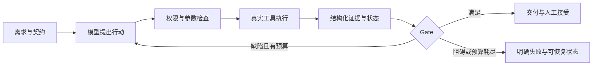

# Agent Harness 场景面试题与回答

> 基于当前仓库源码、[源码精读系列](source_walkthrough/README.md)和[评测复盘](modules/05_evaluation_and_incidents.md)。  
> 基础知识题见 [面试题库](modules/06_interview_question_bank.md)。本文重点回答“出现问题时如何判断、处理和验证”。

## 使用方式

每题先用“面试回答”讲 45 至 90 秒，再根据追问展开。答案中的“当前”表示已有机制，“进一步改进”表示设计建议，不能在面试中混用。

推荐回答结构：

```text
明确风险和判定标准
  -> 定位证据与责任层
  -> 当前机制如何处理
  -> 未覆盖部分如何改进
  -> 用什么指标/测试证明有效
```

不要只说“优化 Prompt、加重试、换模型”。说明具体状态、动作和结果；不要把单元测试通过说成真实任务成功，也不要把 Gate 正确拒绝失败说成候选代码已经可用。

## 一、四个核心问题

### 1. Agent 重复调用同一个工具，如何解决？

**面试回答：**

我先判断重复是否必要。相同 read_file 可能因为文件改了需要重读，测试也可能在修复后重跑；真正的问题是没有新信息的重复调查，或重复执行有副作用的操作。定位时我会看工具名、规范化参数、结果、当前文件/任务状态，以及是否跨 retry 或 resume，而不是只看 tool_call_id。

当前项目已把 LLM transport retry 放在响应返回前，避免因为下一轮模型请求重试而重放已完成工具；Workflow 用 attempt checkpoint 保存动作、失败和下一步，减少新 Agent 从头探索。文件编辑有旧文本匹配和可选 hash 检查，Task/Artifact 有状态与版本约束。但还没有通用重复动作检测或 exactly-once 工具执行。

进一步我会对“动作相同、相关状态没变、结果相同且没有推进”的循环做检测，先把已有结果和未完成目标回灌，达到阈值再停止或请求人工处理。对写工具则优先做业务幂等和结果核验，不能直接把相同参数全部去重。

**追问：如何定义动作指纹？**

使用 tool name、结构化规范化 arguments、workspace/workflow scope 和必要状态版本。例如读取文件关联文件 hash，验证关联最终 diff 与执行环境，Artifact 更新关联版本。call_id 是调用相关性，不是业务幂等键。

**追问：是否可以缓存所有工具结果？**

只缓存可判定有效期的读结果，状态变化就失效。测试结果还依赖环境、选择目标和外部服务，单凭代码 hash 不足以永远缓存。Bash 可能修改文件或调用远程服务，不能透明缓存或重试。

**验证方法：**重复只读动作比例、跨 attempt 重复调查次数、副作用实际发生次数；加入“动作执行后、状态保存前崩溃”的故障注入。通用指纹检测是建议能力，当前未实现。

**源码入口：**[Recovery](source_walkthrough/07_recovery_system.md)、[Memory/工作记忆](source_walkthrough/08_memory_system.md)、[Workflow resume](source_walkthrough/14_workflow_persistence_and_resume.md)。

### 2. Agent 没有遵循 Skill 的限制和描述，怎么办？

**面试回答：**

我会先区分知识没有被看到、模型没有理解，以及必须执行的限制没有被系统落实。检查 Skill 是否发现、required 正文是否进入请求、optional 是否调用 skill_load、reference 是否读取，以及压缩后正文是否仍可见。required 只能保证提供指令，不能保证执行。

如果限制涉及不能写源码、不能读敏感文件或不能绕过 QA，就必须落在工具 allowlist、PermissionHook、工具校验或 Workflow Gate 中，不能只放在 Skill。PRD 是否包含验收条件这类交付要求，可以增加结构化检查；风格和质量类要求则用清单、样例或受控审查评估。

当前项目已支持 required/optional 和现有执行权限、交付 Gate，没有通用 Skill compliance checker。进一步应把 Skill 中关键要求映射为可验证的 postconditions，失败时反馈具体缺项，而不是反复重发整份 Skill。

**追问：为什么不把 Skill 全放进 System Prompt？**

required 本来就预注入，但长指令仍可能冲突或被忽略，还增加每步成本。权限约束要程序化；方法指导按需披露，关键交付条件外部验收。

**追问：Skill 要交互澄清，串行角色却不能等用户怎么办？**

当前 worker 指令要求在需求有可用核心时记录假设、问题和风险并继续交付。涉及不可替代业务决策时应显式暂停/请求输入，这类流程需要新增明确状态，不能声称当前已具备通用人机交互节点。

**验证方法：**有无 Skill 的同任务对照、关键条件覆盖率、违规行动被拦截率和额外 token/延迟。skill_load 成功只证明加载，不证明质量提升。

**源码入口：**[Skill](source_walkthrough/11_skill_system.md)、[Security](source_walkthrough/06_security_system.md)、[Evidence Gate](source_walkthrough/13_workflow_evidence.md)。

### 3. 整套 Agent 流程最难的环节是什么？

**面试回答：**

对我的项目来说，最难的是让模型描述、执行状态和验收证据始终一致，尤其在长任务、失败和恢复之后。模型可能说已完成，但没写报告；报告可能说 changed，但当前阶段没有改代码；QA 可能说 pass，但工具结果失败。只让下一角色读上一角色回复，错误会沿流程传播。

我用三层状态和 Evidence Gate 解决：Context 保存本轮因果链，Workflow checkpoint 保存任务进展，长期 Memory 只保存稳定知识；Task/Artifact 表达交接，真实 Git diff 和 verification event 决定可检查事实。恢复时继续同一 Worktree，注入有界进展，而不是把长期记忆当任务日志。

真实评测既发现了 QA 假 pass，也发现 metadata 契约过严会误伤已有成果。因此我进一步区分可按机器事实修正的漏项和必须失败的语义冲突。目前闭环能拒绝一些错误成功，但真实实现成功率和 token 效率还需要继续评测。

**追问：最能体现个人设计贡献的两个点？**

讲“三层状态的职责边界”和“报告/验证/最终 diff 的证据绑定”，各用一个真实故障展开，不罗列所有模块。

**证据口径：**Run 02 重复探索、Run 03 叙述与工具失败冲突、Run 04 changed_files 漏项。历史评测与当前规则要分开，旧运行中某些阶段接受 max_steps，当前代码已要求 completed。

### 4. 如何在不确定的模型决策与真实执行环境之间建立可靠闭环？

**面试回答：**

我把模型作为提出行动和解释结果的决策者，Harness 负责决定行动能否执行，以及结果是否满足可检查条件。闭环从明确需求、Task 和交付契约开始，再通过工具参数处理、权限与工作区限制执行；结果用结构化反馈回给模型，最终用机器验证和 Gate 决定通过、修复、重试或失败。

例如 Engineer 修改 Worktree 后跑测试，Harness 把验证和报告绑定到最终 diff。QA 的自然语言 pass 与机器失败冲突时，权威 verdict 降为 fail，进入有界修复，而不是把错误报告传给 PM 接受。整个过程保存 Trace 和工作 checkpoint，用于归因和恢复。

可靠并不意味着模型永远正确，而是系统能控制风险、发现部分错误，并把无法满足的任务明确判失败。hash 只证明状态一致，测试也可能覆盖不足，所以最终还需要仓库外的冻结验收。



**追问：哪些已经是硬约束？**

角色工具裁剪、路径/敏感文件检查、Task 状态转换和非空 evidence，以及 Worktree Workflow 的机器证据 Gate。工具 schema 并不等于当前所有入口都有完整 JSON Schema runtime validator；通用 ToolRegistry 主要调用函数并捕获错误。

## 二、工具、协议与副作用

### 5. 外部工具超时，不知道是否已经执行成功，能否重试？

**面试回答：**先区分生成请求和业务动作。LLM 超时可以有界重试，响应未交给 Agent 时本地工具尚未执行；远程写操作超时可能已经成功，必须查询状态、使用业务幂等键或人工确认，不能透明重放。

当前 MCP 调用失败关闭相关 session 并返回错误，没有自动重试所有 remote calls。重连只恢复连接，不证明之前动作未发生。支付、发消息、创建远程资源这类工具需要服务端幂等协议，进一步可记录 operation_id、intent/result 和补偿状态。

**追问要点：**同参数不代表同一次业务意图；本地日志无法单独实现跨系统 exactly-once。

### 6. 多个工具调用里前两个成功，第三个失败，怎么办？

**面试回答：**当前按顺序执行并回灌每条结果，前面副作用不会自动回滚，也不会整批重试。模型应根据各结果继续缺失动作，Trace 保留调用顺序。

有跨动作不变量时，应由工具实现事务或显式补偿，不能期望 Agent 的多 Tool Call 天然是 transaction。进一步可将强关联动作封装成一个受控业务工具。

**追问要点：**Provider 消息中必须保留对应 call/result；模型异常不能让系统忘记已发生动作。

### 7. 模型生成错误参数或调用不存在工具，如何处理？

**面试回答：**在适配边界处理参数形态，无法执行的输入回灌错误，未知工具由 Registry 返回 unknown tool。函数参数和工具内部业务校验继续拦截非法操作，给模型具体反馈。

当前不应宣称拥有通用完整 schema validator。artifact_create 还有特定 object-array 批量兼容路径，按顺序逐项执行；其他非法数组不随意转换成写动作。进一步应把参数校验放在统一执行入口，同时保留工具内部的状态/路径检查。

**追问要点：**schema 是接口契约，兼容规则需要白名单和测试，不能为了容错任意猜参数。

### 8. 编辑文件前后有别的进程改了文件，怎么办？

**面试回答：**read/edit 之间检查版本。当前写/编辑工具可传 expected_sha256，edit 要求 old_text 精确出现一次，失败就重读并重做局部判断，不能自动在未知代码上强行替换。

hash 参数可选，检查与写入也不是原子 CAS；并行编辑还需要锁、事务或独立 Worktree。原子文件替换只避免半写，不保证没有 lost update。

**验证方法：**注入并发修改，确认 stale edit 被拒绝、文件未被静默覆盖。

### 9. Agent 开始执行可能危险的 Bash，怎样阻止？

**面试回答：**先看角色是否有 Bash，再经过权限 Hook 的硬拒绝/用户确认，以及执行环境、工作目录、timeout 和输出控制。凭据不自动传给子进程，代码改动留在 Worktree。

当前 Shell 字符串策略只能降低误操作风险，用户批准的脚本仍能使用宿主权限。高风险部署应增加容器/OS sandbox、网络和资源约束，而不是扩大命令黑名单。

**追问要点：**确认不是安全证明，Worktree 不是进程沙箱。

## 三、上下文、记忆与预算

### 10. 上下文超限后，如何避免压缩丢失关键状态？

**面试回答：**先治理大工具结果并保存完整内容，再按 Tool Call/Result 原子组摘要较早历史，保留近期因果链和用户目标，最后才 hard trim。Task/Artifact/Memory 下一步重新加载，任务 checkpoint 保存继续点。

当前有启发式请求 token 估算和 reactive recover，仍可能丢摘要细节。压缩应优先保留未完成目标、修改状态、失败与下一步，而不是均匀缩短每条消息。

**验证方法：**压缩后重复调用率、协议错误、目标保持率和交付成功率，不能只看压缩比。

### 11. 恢复后 Agent 又从头开始，为什么 Worktree 没有帮上忙？

**面试回答：**Worktree 保存代码，不保存为什么修改、还差什么。新的 Agent 没有旧 messages，需要 checkpoint 提供 objective、completed、remaining、失败和下一动作。

当前 Workflow 保存滚动事件和 attempt handoff，并注入新请求；普通 CLI 没有同等跨进程工作恢复。恢复效果还要看最新 checkpoint 是否被选中，不能看到文件仍在就认为短期记忆有效。

**追问要点：**当前已有 handoff 时，后续中断 attempt 的最新滚动 state 有覆盖边界，完整性要结合 Trace 检查。

### 12. 记忆和当前文件冲突，应该相信谁？

**面试回答：**当前请求和新工具证据优先。Memory 是历史假设，发现旧测试命令/架构过期后应 mark_stale 或更新明确事实，而不是照旧知识改回代码。

当前 active/pinned 召回、stale/archive/forget 已有；没有自动扫描仓库判矛盾或按时间衰减。confidence 是模型/调用者赋值，不是正确率。

**追问要点：**长期库不存本次失败进度；失败 Workflow 不做成功反思不等于记忆坏了。

### 13. 相关 Memory 没有召回，如何排查？

**面试回答：**查状态是否 active、目录是否超预算、query 是否误取内部消息、selector 返回和预算排序。pinned 占名额，普通候选只能看到 metadata；正文关键词仅用于显式 search。

当前 selector 异常降级关键词，但无法解析的结果可能被当空选择，不再 fallback。改进应区分合法空结果与解析错误，增加可观测原因；规模增加后再评估 BM25/向量索引。

**验证方法：**相关条目 Recall@k、错误注入率、成本/延迟；use_count 只表明被注入，不证明有用。

### 14. 输入 token 很高，应该加大压缩频率吗？

**面试回答：**先从 Trace 按 operation/phase 分摊成本，区分历史、每步 runtime Artifact/Memory、required Skill、tools schema 和重复工具读取。反复注入的大固定内容不会因压缩 history 消失。

当前 catalog、preview、selection cache 和摘要有局部预算，但没有通用 delta context 注入。进一步优先按阶段选相关资料、减少重复块和无效调查，再评估真实 tokenizer 与 provider cache；缓存是否可用要按当前服务验证。

**追问要点：**以历史 Run 05 的高 input token 作为问题证据，不声称成本优化已有显著实测收益。

### 15. 角色一直调查，直到 step 用完还没交付，怎么办？

**面试回答：**把交付条件和验证步骤放进 phase contract，预算接近耗尽时提示保存进展、收敛到验证/报告。已经完成代码却缺交付，checkpoint 要让下一 attempt 只补缺项。

当前角色 max_steps、有界 phase retry 和 budget progress 已有；没有整个 Workflow 的硬费用上限。增加 step 只会放大无效探索，应同时衡量有效行动和交付率。

**追问要点：**max_steps 是工具轮次约束，output/context/transport recovery 可增加实际 LLM call 数。

## 四、协作、证据与恢复

### 16. Engineer 写了报告，但没有实际改代码，如何识别？

**面试回答：**Worktree 模式对比本 phase baseline 与最终 diff，change_required=true 却没有真实变化就拒绝；changed 还要有最终 hash 对应成功验证和报告写入 snapshot。

报告 changed_files 漏项可按 Git 修正并 warning，outcome 与 diff 冲突则失败。shared 模式没有同等证据绑定，不能把强保证推广到它。

**追问要点：**diff 改变只是必要条件，不证明改动相关或实现正确。

### 17. 测试失败但 QA 声称通过，怎么办？

**面试回答：**以结构化 verifier outcome 为权威，把 reported pass 降为 effective fail，保留原声明和机器证据，交给修复循环。PM acceptance 的 verdict/status 也必须与权威 QA 一致。

当前 Gate 会区分环境阻碍和 actionable failure。QA phase 完成可表示“有效检验并发现失败”，不等于需求通过。

**追问要点：**当前同 QA attempt 的失败记录不会自动被后续成功清掉，可能保守降级；改进需定义同目标、环境和最终状态的覆盖规则。

### 18. QA 缺依赖跑不起来，应让 Engineer 改代码吗？

**面试回答：**先识别执行环境、manifest/lock 是否正确，再区分项目漏依赖、锁不一致、权限、网络和测试断言失败。不能把工具起不来当功能 bug。

当前验证器用目标项目环境并记录 error_kind/missing_modules/diagnostic，QA Gate 对纯工具/环境阻碍留在本阶段 retry。项目依赖确实缺失时由 Engineer 修改 manifest/lock 或隔离环境，不污染 Harness 共享解释器。

**追问要点：**当前没有独立环境修复角色或保证所有阻碍都能自动解决。

### 19. 测试通过之后又改代码，之前结果还能用吗？

**面试回答：**不直接复用。当前把 verification 绑定 diff hash，最终代码变化后旧 hash 不能证明新状态；报告也要匹配最终快照。

同 hash 仍不包含依赖环境、服务状态和所有 ignored 文件。因此更强复现需要记录环境指纹、测试选择和外部 checker 版本。

**追问要点：**hash 证明相同交付状态，不证明时间顺序，也不证明测试覆盖完整。

### 20. Phase retry 和缺陷修复循环有什么区别？

**面试回答：**retry 是本角色没满足完成协议，例如漏报告、max_steps 或环境阻碍；fix cycle 是 QA 有效完成后给 fail，Engineer 修复并由 QA 回归。计数分开，否则一次报告格式修正就可能浪费缺陷修复预算。

当前还有 LLM transport retry，发生在更底层。Agent 异常会保存 failed 并等待 resume，不是所有错误都使用 phase retry。

**追问要点：**显式 resume 可以获得新的本地 attempt 预算，当前没有总次数/成本硬上限。

### 21. 已创建 Artifact，但 Agent 达到 max_steps，能算成功吗？

**面试回答：**当前不能。phase 要同时满足 Agent completed 和 Gate。否则记录 artifact_gate_ok 并 continuation，让新 attempt 补收尾，不重做已完成代码。

这解决了历史评测中“有交付物就接受未完成角色”的问题，也避免误把最后工具调用当整个流程完结。

**追问要点：**旧评测曾允许 max_steps phase completion，要说明规则演进，不把历史行为当当前代码。

### 22. Resume 是否保证不重做、重新验收最新文件？

**面试回答：**它复用同一工作区和 checkpoint，降低重做；但不保证没有工具重复。completed result/checkpoint 标记一致时快速复用，不重跑所有 Gate，只有特定恢复路径重新检查。

Task/Artifact/代码保存不是跨文件事务，完成标记也不是实时验收。需要新鲜验证应显式运行，进一步可增加依赖状态失效策略和配置/环境快照。

**追问要点：**当前最新滚动 state、终态 Task 和已经改变的配置都有恢复边界；不承诺任意崩溃点完整无损接续。

### 23. 两个 Agent 同时 claim Task 或更新 Artifact，会怎样？

**面试回答：**当前主要按串行运行设计，Task claim 是读改写，无原子锁；Artifact expected_version 可检测已提交旧版本，但可省略且不是 CAS。两并发写者仍可能竞争。

并行拓展要先加原子 claim/lease、状态版本和 Artifact CAS，每分支 Worktree、冲突审查及取消/预算控制，再增加并发 Worker。不能把 thread pool 当多 Agent 协作协议。

**追问要点：**原子文件 replace 不等于并发原子更新；owner 字段不等于认证身份或锁。

### 24. Task 出现循环依赖或上游取消，怎么办？

**面试回答：**当前 can_start 只接受全部直接依赖 completed，缺失或 cancelled 会阻塞；没有 DAG cycle detection。创建图后可能永远不可执行，应报告阻碍并修正依赖，而不是强行 claim。

进一步在最终图状态校验自依赖和环，定义取消传播/替代任务。状态变更与 blocked_by 同时更新还需检查新状态的依赖一致性。

**追问要点：**priority 目前排序展示，不是动态 ready-task scheduler。

## 五、安全、扩展与运行故障

### 25. 搜索结果、MCP 返回或 Skill 文本有恶意指令，怎么办？

**面试回答：**把它们视为外部数据，不能因一段文本获得工具权限或改验收标准。关键限制落在能力裁剪、执行校验和 Gate；避免 secret 进入上下文/日志，危险动作请求确认。

当前有 precedence policy 和执行层保护，但没有形式化 Prompt Injection 防护或完整 sandbox。Skill root symlink/敏感资源和外部 MCP 权限仍有边界。服务化要补来源标记、租户/凭据隔离和执行沙箱。

**追问要点：**已预注入 System 的 required Skill 尤其要审查；不能靠“最高优先级请忽略恶意指令”解决全部风险。

### 26. MCP Server 断连、工具变了、外部写权限过大，如何处理？

**面试回答：**看连接、发现、权限和业务调用分别在哪失败。当前 Manager 做 namespaced binding、role scope、permission 和错误规范化，调用异常关闭 session，下一次可重新连接。

工具集在发现/注册后不是无限动态更新，改变服务工具需要受控重发现。高风险写服务应最小权限，重连不自动重试不明结果的业务写；默认也不把所有 MCP 工具发给所有角色。

**追问要点：**OAuth/token refresh 属于尚未实现的 credential lifecycle，不是 MCP tool adapter 自动提供的能力。

### 27. 后台命令结束了，模型没收到或收到两次通知，怎么办？

**面试回答：**区分 job 事实状态和通知投递状态。当前 Manager 用队列加去重集合，terminal/unnotified 状态落盘，Agent 收集后 acknowledge；恢复时重新排未通知终态。

进程重启不会接管未知原进程，created/running 会标 interrupted。这是恢复状态，不是可靠持久作业调度器。通知 ack 与对话上下文不是跨进程事务，仍需通过 job ID 查询，不能声称 exactly-once 投递。

**追问要点：**后台 job 的 task_id 只是关联，不自动完成 Task；当前 Workflow 角色也未默认开放后台工具。

### 28. LLM 返回工具调用被截断，或者长回复一直超限，怎么办？

**面试回答：**输出截断先提升 token 上限重跑，丢弃第一次草稿；纯文本仍截断再有限续写，耗尽返回 incomplete。截断 Tool Call 不执行，避免残缺意图引发副作用。

超时走传输 retry，context 超限先压缩再新请求；三者不能混用。需要同时检查真实模型 context/output capability 和配置，不能无限提高 max_tokens。

**追问要点：**retry elapsed budget 不是严格端到端 deadline，下一请求时间仍受 SDK timeout 控制。

### 29. 日志写失败、CLI callback 抛错，会影响 Agent 吗？

**面试回答：**Trace 默认 non-strict，写盘失败记录 last_error 并降级；strict 模式可失败。Event callback 当前直接调用，抛异常可能中断 Agent/恢复链；Hook 异常也会传播。

因此不能说“Hook/Event/Trace 分离就保证所有展示失败都不影响执行”。进一步应为可选 UI observer 提供隔离，对权限/状态存储则定义 fail closed，分别设策略。

**追问要点：**Workflow 的 phase_on_event 含必要状态保存，不应一概吞掉所有 observer 错误。

## 六、评测、取舍与项目表达

### 30. 模型写了实现又写测试，测试全过，为什么仍可能不可靠？

**面试回答：**实现和自写测试可能一起偏离需求，形成自证循环。当前评测分 Harness Gate、目标回归和仓库外冻结 contract，验证真实 HTTP/SSE/approval 等行为。

QA 角色隔离降低混用，但同一模型和上下文来源仍可能有相关错误；独立 checker 才提供额外证据。测试数量不等于需求覆盖。

**追问要点：**Gate 正确只说明符合当前可检查规则，不是所有业务正确。

### 31. 如何区分模型、Harness 和评测环境的问题？

**面试回答：**固定输入/环境，按责任边界检查。模型虚构 API 或代码 placeholder 属候选问题；Harness 把 tool_error 当 test pass 属流程问题；baseline 漏依赖、错误 checker 属评测问题。

先做最小重现和定位，再增加针对责任层的回归。不能看到失败就换模型，也不能把所有 compatible API 异常都怪后端。

**验证方法：**保留 baseline、task/config/model、Trace、最终 patch、目标环境和外部 checker 结果，分别记录 candidate/harness/benchmark findings。

### 32. 项目评测失败很多，简历里该如何讲价值？

**面试回答：**如实区分任务成功和故障识别。历史 self-hosting Run 05 候选 API 和外部 contract 失败，但验证了假 pass 降级、验收冲突拒绝、Worktree 隔离和依赖归因；同时暴露了很高 token 成本。

我会用一个问题的 Trace、归因、系统修复和单元/场景回归讲工程贡献，明确实际任务成功率尚未充分建立，不把一次门禁拦截包装为全部交付成功。

**追问要点：**数字引用 [Run 05 原始复盘](../evaluation/self_hosting/results/api-run-05.md)，说明它是历史版本结果，不是当前仓库再次实测指标。

### 33. 现在该先增加 Agent Team，还是提高串行可靠性？

**面试回答：**看瓶颈。当前真实问题主要是证据一致性、重复工作和成本，先提高串行完成率、外部 contract 通过率和复现能力更有价值。并行只提高独立工作吞吐，可能放大错误和成本。

后续真需要多任务并行，再补 claim lease/CAS、独立分支 Worktree、冲突审查、取消传播和调度 budget。框架换成图调度也不会自动解决这些问题。

**追问要点：**选择最小闭环体现业务判断，不按教学章节数量衡量完成度。

### 34. 如果要服务化并支持多个用户，先改什么？

**面试回答：**先定义运行所有权与 tenant scope，把本地文件管理换成有事务/锁的状态服务，加入作业队列、鉴权、审批事件和隔离执行环境。不要把同步 CLI loop 简单包 HTTP 就认为完成服务化。

当前 ContextVar、事件模型和 Manager 分层可复用，但不提供租户 ACL、分布式 lease、持久 token store、完整会话恢复或运行中取消协议。实现顺序应先可靠 run lifecycle，再流式展示和吞吐优化。

**追问要点：**内部依赖环境、secret、MCP 账号和 Worktree 必须按租户隔离。

## 场景与模块速查

| 题目 | 主要模块 |
| --- | --- |
| 1、5—9 | Agent、LLMClient、Tool、Recovery、Security |
| 2、25 | Skill、Permission、能力裁剪 |
| 10—15 | Context、Memory、Task、预算 |
| 16—24 | Workflow、Artifact、Task、Worktree、checkpoint/resume |
| 26—29 | MCP、Background、Trace、Hook/Event |
| 3—4、30—34 | 全链路设计、评测和演进 |

## 面试前优先练习

先练 1—4 四个核心问题，再练 11、16—19、22—23 和 30—32。每题准备一个源码入口、一个真实案例和一个当前限制。

常见表述修正：

| 容易夸大的说法 | 推荐说法 |
| --- | --- |
| required Skill 保证遵循 | 保证指令可见，执行仍由模型决定，关键条件外部检查 |
| Schema 保证所有参数正确 | 形态处理、函数参数与工具业务校验已有，完整通用 schema validator 尚未实现 |
| version 防止并发覆盖 | 当前读时版本冲突检查，非原子 CAS |
| resume 完全不重复 | checkpoint 降低重做，无 exactly-once |
| Worktree 是安全沙箱 | 隔离 Git 改动，不隔离宿主进程权限 |
| Gate 通过就是业务正确 | 满足当前可检查规则，还要外部契约和需求覆盖 |
| Trace/Event 分层后观察失败无影响 | Trace 可降级，callback 仍有异常传播边界 |
| 记忆越来越多代表能力更强 | 评估召回质量、错误污染、完成率与成本 |
| 多 Agent 必然更强 | 独立任务可提高吞吐，协作成本和相关错误需评测 |

## 可执行的评测方案

以下是建议新增的场景评测，不是当前已完成测试结果：

1. 重复工具：静态状态反复 read、代码改变后的合法 reread、副作用重放。
2. Skill：未加载、压缩后丢正文、规则冲突、硬约束被违反、纯质量缺项。
3. 证据：假 pass、旧 hash、no diff、环境阻碍、报告 metadata 漏项。
4. 恢复：动作后落盘前中断、第二 attempt 中断、Worktree 缺失、配置变化。
5. 并发：双 claim、双 Artifact update、同文件 stale edit。
6. 安全：外部 Prompt Injection、敏感路径、权限拒绝、危险 Shell。
7. 效率：固定任务比较 token、有效工具占比、重复调查、完成率和延迟。

每个场景都定义正确通过和正确拒绝两类结果。对硬约束检查违反率，对恢复检查重做和副作用，对方法质量做成对评测；避免只报单一总体成功率掩盖成本或不安全动作。
