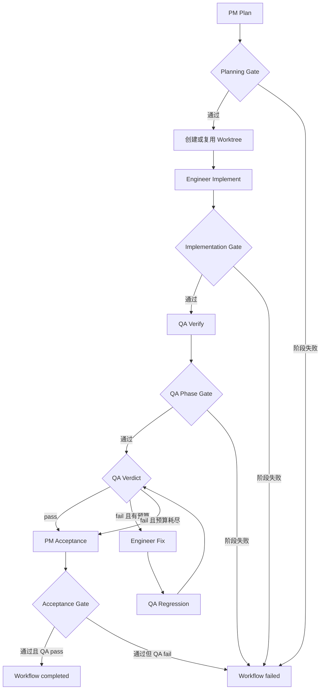

# Serial Workflow 编排源码精读

> 核心：[serial_workflow.py](../../src/llm_agent/serial_workflow.py)  
> 接入：[main.py](../../main.py)、[agent.py](../../src/llm_agent/agent.py)  
> 配套：[Workflow Evidence](13_workflow_evidence.md)、[Workflow 配置与恢复](14_workflow_persistence_and_resume.md)  
> 测试：[test_serial_workflow.py](../../tests/test_serial_workflow.py)

## 1. 模块定位

SerialCodingWorkflow 是确定性 Orchestrator。它负责调用角色、检查交付、维护阶段状态、控制修复次数和保存恢复信息；PM、Engineer、QA 和 PM Acceptance 是阶段 Worker。

每个 Worker 仍运行已有 Agent ReAct Loop，但“接下来调用哪个角色、是否进入修复、何时结束”由 Python 控制。没有额外 LLM Orchestrator，也没有基于 Task DAG 自动动态派发。

阅读本组文档的顺序：

1. 本篇：类、角色装配、阶段循环和完整工作流程。
2. Evidence 篇：Worktree、真实验证和阶段验收。
3. Persistence 篇：配置、文件状态、attempt checkpoint 和 resume。

## 2. 状态类型与数据模型

| 类型 | 值/含义 |
| --- | --- |
| WorkflowStatus | completed / failed，最终返回结果 |
| WorkflowPhaseStatus | completed / failed，单阶段返回结果 |
| WorkflowIsolation | shared / worktree |
| WorkflowPhase | pm_plan、engineer_implement、qa_verify、engineer_fix、qa_regression、pm_acceptance |

注意持久化 WorkflowRunRecord 另外支持 running/interrupted；AgentRunResult 又可为 max_steps/incomplete。它们属于不同层级，不能直接互换。

### 2.1 RoleSpec

frozen dataclass，字段包括 name、agent_id、instructions、tool_names、required_skills、optional_skills、max_steps。

它定义角色能力和 Prompt，不保存角色的运行 messages。frozen 只限制字段重新赋值，内部 set 仍是可变对象；构造角色时使用 set(role.tool_names) 复制。

### 2.2 WorkflowPhaseResult

保存 phase、role、status、run_ids、artifact_ids、summary、attempts、error 和 data。

data 包含 agent_status、验证、Worktree baseline、快照、handoff、Gate 警告等。phase_key 不是 dataclass 字段，序列化到 record.phases 时由 Store 增加。

### 2.3 WorkflowResult

保存 workflow_id、最终 status、所有 phase results、artifact IDs、qa_verdict、fix_cycles、Worktree review 和 error。

worktree 是审查结果，不代表补丁已 apply。accepted 报告与主工作区接受代码是两个操作。

### 2.4 _GateResult

内部值对象：ok、message、artifact_ids、data。Gate 返回结构化 issue，阶段循环可以把它注入 corrective prompt，而不是只打印一段错误。

## 3. SerialCodingWorkflow 字段

| 字段 | 用途 |
| --- | --- |
| llm | 所有角色复用的 LLMClient |
| workdir | 根项目和运行状态目录 |
| artifact_manager | 共享交付物 |
| workflow_store | run/phase 持久化；默认创建 |
| worktree_manager | worktree 模式默认创建 |
| approval_provider | 工具调用确认 |
| skill_registry | 方法和资源 |
| memory_manager | 共享长期记忆 |
| mcp_manager | 按角色 scope 暴露外部工具 |
| isolation | 默认 worktree |
| role_specs | 四个默认角色 |
| max_fix_cycles | 默认 1，缺陷修复循环预算 |
| max_phase_retries | 默认 1，额外阶段 attempt 次数 |
| max_context_tokens | 默认 100000 |

__post_init__ resolve 根目录，补默认 Store/WorktreeManager，检查 isolation、必需角色和非负 retry/fix budget。

依赖由 main.py 组装。Workflow 不使用 Main Agent 的 messages，也不把 Main 对话完整复制给角色。原始 workflow request 和持久化交付物提供主要上下文。

## 4. 角色与能力分配

| 角色 | 默认 max_steps | 主要能力 |
| --- | ---: | --- |
| PM | 10 | 阅读/搜索、Task、Artifact、Memory read、Skill |
| Engineer | 24 | 上述能力 + 写/编辑/Bash、测试/lint |
| QA | 16 | 阅读/搜索、Task/Artifact、结构化测试/lint，无通用 Bash/源码写工具 |
| PM Acceptance | 8 | 使用 PM 工具 profile 做最终审查 |

所有默认角色可使用 Skill。Memory 只读，关闭 worker Stop 自动抽取；完成后 Harness 统一反思。

Workflow 默认角色没有 subagent_run/background/worktree 管理工具，因此不会自行创建嵌套团队或合并代码。

MCP 工具根据 agent_id 对应 scope 额外加入。外部 MCP 行为仍取决于服务端与权限配置，不能仅凭本地 profile 断言绝对只读。

## 5. _build_role_agent() 装配流程

1. 根据 agent_id 查 MCP scope。
2. build_default_registry 构造工具，再 subset 到角色 allowlist + scoped MCP。
3. PromptSection 加 workspace、workflow、role、worker_output。
4. 加只读 Memory policy、Skill sections、Artifact policy、工具摘要。
5. 若代码执行目录不同于根目录，增加隔离说明。
6. ContextManager 使用根 workdir 管理上下文文件，keep_recent_tool_results=8。
7. Hook 的文件权限使用 execution_workdir，Task/Artifact 注入使用根共享状态。
8. 创建 Agent：角色 max_steps、agent_id、parent_run_id=workflow_id、depth=1。

目录分工：

```text
Role file/bash/verification -> execution Worktree
Task tools/hooks           -> root tasks/<workflow_id>
Artifact                   -> root shared ArtifactManager
Memory/Skill               -> root shared managers
Context transcript          -> root ContextManager workdir
```

角色是新 Agent 实例，但共享 LLMClient 和受控 Manager。上下文隔离与文件状态共享同时存在。

## 6. run() 入口

run(request, on_event=None, run_id=None, trace=None)：

1. 拒绝空 request。
2. 使用传入 run_id，或生成 workflow-UUID。
3. 快照启动前 Artifact IDs。
4. create_run 保存原始 request 和 running 状态，拒绝重复 ID。
5. 创建/认领 orchestrator root Task。
6. 进入 workflow trace_scope。
7. 记录 workflow.started，调用 _execute_record。

create_run/root 初始化发生在 scope 前。初始化或装配异常不是所有都自动转换为 WorkflowResult，调用方仍可能收到异常。

## 7. _execute_record() 固定阶段流程



图中 phase Gate 内有自己的 retry；Worktree setup、fix/regression/acceptance 阶段失败也会结束流程。

### 7.1 PM planning

PM 在根项目只读调查并创建 PRD/TaskSpec、角色子 Task。Gate 通过后才创建 Worktree，避免无效规划生成无用开发目录。

### 7.2 Engineer implementation

工作目录切到隔离 Worktree，读取规划交付，修改代码、验证并提交报告和完成 Task。

### 7.3 QA verification

在同一 Worktree 测试。如果 phase Gate 失败，例如工具阻碍或缺报告，先 retry QA phase；如果 phase 完成并得到 verdict=fail，才进入 Engineer 修复。

QA phase completed 表示验证流程交付有效，不要求 QA verdict=pass。

### 7.4 bounded fix loop

局部 fix_cycles 从 0 开始，按编号遍历 engineer_fix_N、qa_regression_N。恢复时利用 _ensure_phase 跳过已完成记录，而不是直接从 record.fix_cycles 处跳转。

Harness 创建新修复 Task，并提供上一 QA 的权威证据摘要。QA 的新 verdict 决定继续或退出。

### 7.5 acceptance 与最终 status

修复预算耗尽后仍会执行 PM Acceptance，让它产出拒绝/阻碍报告。只有最终 qa_verdict=pass 且 acceptance phase 成功时，Workflow 才 completed。

## 8. phase 与 phase_key

phase 描述角色动作类型，phase_key 标识具体阶段实例：

```text
phase=engineer_fix, phase_key=engineer_fix_1
phase=engineer_fix, phase_key=engineer_fix_2
```

Task metadata.task_key、Store checkpoints 和阶段结果使用 phase_key；角色/Prompt 和证据类型主要使用 phase。

## 9. _ensure_phase() 与 _run_phase()

_ensure_phase 先判断已有结果是否可复用，再尝试从 completed checkpoint 恢复；均不可用时调用 _run_phase。恢复条件见 Persistence 篇。

_run_phase 管理阶段 attempt：

1. 取得原始 Artifact version baseline。
2. 恢复 handoff、previous_attempts 和 retry issue。
3. 在证据阶段记录首次 worktree_before；重试继续保留原 baseline。
4. mark_phase_started。
5. 开启最多 max_phase_retries+1 个本地 attempt。

baseline 保留的意义是一个阶段可以分多次 attempt 完成。前一次已改代码、后一次只补报告，也可以围绕本阶段原始 baseline 验收；新的 engineer_fix phase 则有新的 baseline。

## 10. 单次 attempt 的具体流程

```text
new role Agent + new messages
  -> base phase prompt
  -> exact phase task contract
  -> prior-role checkpoint（适用时）
  -> corrective prompt + latest handoff（重试时）
  -> persist current_attempt/current_run_id
  -> Agent.run(phase_on_event)
  -> Gate(before_versions, latest phase data)
  -> check Agent status
  -> build and persist attempt handoff
  -> completed / next attempt / failed
```

phase_run_id = workflow_id-phase_key-attempt。attempt 使用 previous_attempts + local_attempt，恢复后编号继续增长。

run_ids 主要是本次 _run_phase 执行产生的 IDs，不保证最终列表保存所有历次 resume 的完整请求历史；handoff/Trace 保留额外来源。

## 11. Agent 完成与阶段完成

即使 Gate 通过，只要 AgentRunResult.status 不是 completed，phase 仍不能完成。

max_steps 或 incomplete 会记录 continuation_reason、artifact_gate_ok，并让新 attempt 继续交付。避免模型在最后一个工具轮次写了报告，却没完成最终回复/收尾，就被误记为成功。

Agent completed 但 Gate 不通过时，continuation_reason=phase_retry，针对缺失契约重试。

## 12. 三层 retry budget

| 预算 | 单位 | 主要位置 |
| --- | --- | --- |
| LLM transport retry | 同一 chat 的 SDK 请求 | LLMClient/RecoveryPolicy |
| role max_steps | Agent 工具轮次 | Agent |
| max_phase_retries | 额外角色 attempt | _run_phase |
| max_fix_cycles | QA 缺陷修复回路 | _execute_record |

max_steps 不严格等于 SDK 请求次数，output/context recovery 可增加请求而不增加工具 step。

默认每次阶段执行最多 2 个 attempt。显式 resume 可重新获得这一次 _run_phase 的本地 attempt 预算，累计 attempt 编号保留。

## 13. 异常与失败

agent.run 抛 Exception 时，_fail_phase_after_agent_error 保存错误、recent actions/failures、当前 Worktree/Task checkpoint，立即返回 failed phase。

它不继续用 max_phase_retries 重跑 provider 异常；LLMClient 已处理传输 retry，用户修复连接/配置后可显式 resume。

捕获边界只包住 agent.run；角色构造、部分 Gate、Store I/O 等异常仍可能直接传播。KeyboardInterrupt 也不属于这里的 Exception 捕获，可能留下 running checkpoint；resume 根据落盘状态处理。

## 14. 收尾 _finish()

1. 收集本 workflow Artifact IDs。
2. 获取 Worktree review/patch；如果期望成功但 review 错误，则降为 failed。
3. 构造 WorkflowResult。
4. 成功完成 root Task，失败标 blocked。
5. Store mark_finished。
6. completed + QA pass 时可做长期 Memory reflection。
7. 写 workflow.completed Trace，其中 status 可为 error。

它不自动 apply、commit、merge 或 remove Worktree。失败也保留工作成果用于诊断和恢复。

## 15. 完整 CLI 示例

```text
/workflow 为当前 Python 项目新增 /health API，并补充测试和 README
/workflow-list
/workflow-show <workflow_id>
/workflow-resume <workflow_id>
```

用户要查看日志里实际 workflow_id，CLI 使用的是输入 run ID，不一定以 workflow- 开头。

典型链路：PM 规划 -> Worktree -> Engineer 改动并测试 -> QA 检查 -> 缺陷修复/回归 -> PM 验收 -> patch review。用户再显式决定是否接受补丁。

## 16. 为什么这样设计

- 固定 Orchestrator 限制流程不确定性，模型把推理用于阶段问题。
- 新角色上下文减少无关过程干扰，Artifact/Task 保持交接。
- 同 Worktree 保证 Engineer/QA/PM 看到同一份文件，避免角色间合并问题。
- Task 控制执行状态，Artifact 说明交付，机器证据判断真实结果。
- 有界 retry/fix 控制时间和成本，不让角色无限互相返工。
- checkpoint 提供任务局部工作记忆，避免每次失败从头探索。

相较 learn-claude-code 的 Subagent/Agent Team 示例，这里先实现可靠串行角色交付，没有常驻 teammate、mailbox 或并行 claim scheduler。

## 17. 当前边界与面试追问

没有动态 DAG 调度、并行角色、每角色独立模型配置、全局费用/deadline budget。配置可限制局部执行预算，但 resume 不保证模型行为完全复现。

Q：这是 ReAct 还是 Orchestrator-Worker？

每个角色内部是 ReAct Loop，上层是确定性 Orchestrator-Worker Workflow，两种结构在不同层。

Q：QA 报 fail 为什么 phase 仍 completed？

阶段完成表示有效执行验证并产出结论；业务验收取决于 verdict，fail 会进入修复或最终拒绝。

Q：为何不每角色一个 Worktree？

串行协作需要共同开发状态。多 Worktree 会引入阶段补丁传递和冲突合并，当前没有并行收益抵消复杂度。

Q：模型自己决定角色顺序吗？

不是。Python 代码决定顺序，模型只决定阶段内工具行动和报告内容。

Q：失败后一定自动恢复吗？

Gate/step 未完成可本地 attempt retry；provider 等 Agent 异常会保存失败并等待显式 resume。恢复还依赖持久化状态和 Worktree 存在。

## 18. 阅读入口

按 RoleSpec/Result -> __post_init__ -> run/_execute_record -> _ensure_phase/_run_phase -> _build_role_agent -> _finish -> 配套 Gate/Store/checkpoint -> tests 阅读。

相关测试验证四角色串行、QA fail 修复、角色能力、共享 Worktree、Task 隔离、Skill/Memory、缺失交付重试及异常落盘。
